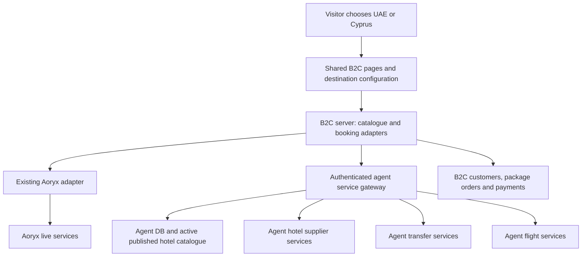

# B2C destination platform: UAE and Cyprus

Architecture direction, updated 15 October 2026. See destination-platform-implementation.md for implemented behavior and remaining booking/payment work.

## Product contract

One MEGATOURS B2C application serves multiple destinations through the existing UAE design and shared components. A flag/name country switcher sits above the homepage hero title. Country selection changes content, inventory and media; search, hotel details, package builder and checkout remain shared. There is no destination select in the header. Destination URLs work directly.

Customers build free combinations in the existing package panel. Hotel only is allowed. A hotel can also be combined with a transfer, a flight, both together, insurance and attractions. There is no "kind of trip" selector.

Transfers and flights cannot be booked independently of a validated hotel. Every selected service needs its own matching, unexpired quote before review or booking. Editing or removing one extra preserves the other selections; a hotel/date/party change invalidates dependent quotes. Preselected insurance and available Cyprus attractions remain editable/removable.

## What already exists

- B2C `lib/db.ts` provides `getDb()` for B2C data and `getB2bDb()` for the agent database. `lib/hotel-info-db.ts` reads `aoryx_hotels`; `lib/aoryx-addons.ts` reads agent transfer/excursion collections. Reuse that existing data ownership.
- B2C `lib/aoryx-search.ts` obtains live Aoryx availability separately from static hotel content. The search parser, room selections, package state, and payment handlers currently use Aoryx types.
- B2C `lib/package-builder-state.ts` stores one package in browser storage, without a destination ID or package mode. Its hotel room selections include supplier-specific rate keys.
- B2C already has `app/[locale]/[destination]/page.tsx` for Dubai, Abu Dhabi, and Sharjah editorial pages. Extend this route deliberately while keeping those existing pages and their URLs available.
- B2C `lib/flight-redirect.ts` builds airline website links for UAE destinations. Flight selections in the builder/checkout are insufficient evidence of an actual flight reservation or issued ticket. Cyprus needs a real booking adapter.
- Agent `src/app/packages/cyprus/page.tsx` uses the shared `DestinationHubExperience`. Its configuration, city catalogue, hotel search, flight quotes, and hotel-specific transfer quotes provide existing behavior to reuse.
- Agent hotel search already supports TBO, Hotelbeds, and GoGlobal. The unified catalogue maps hotel identities to supplier codes. Actual enabled suppliers, Cyprus coverage, and available rates still require environment and inventory validation.
- Agent hotel catalogue publication can use generated collection names through `hotelCatalogGeneration.mjs`. Reading a hardcoded `unifiedhotels` collection from B2C could miss the active published catalogue.
- Agent hotel/flight/transfer routes depend on agent authentication and commercial context. There is no verified general B2C service gateway in the inspected routes; adding one is implementation work.

## Destination configuration and routes

Introduce a typed destination registry with stable IDs such as `uae` and `cyprus`. Keep configuration separate from localized editorial content and supplier credentials.

Each entry defines:

- Country and canonical catalogue scope; supported cities, tourist areas, airport relationships, map bounds, and default search values.
- Localized names, home-page copy, hero media, imagery and navigation. Preserve the existing UAE design and shared page/component system for every destination. Place the flag/name switcher above the homepage hero title; do not add a separate entry design or header select.
- Hotel, transfer, flight, excursion, and insurance capabilities, with explicit provider adapter IDs.
- Supported optional services and availability flags for search and booking; the hotel is the base for every combination.
- Display currency defaults and commercial policy references. Payment currency, nationality, and departure airport remain independent of destination country.

Use destination URLs as the source of destination context:

```text
/{locale}                                      Existing homepage, UAE default
/{locale}/{destination}                        Same homepage, country-specific data/copy
/{locale}/results?destinationId=cyprus          Shared search results
/{locale}/hotels/{hotelId}?destinationId=cyprus  Shared hotel and room selection
/{locale}/checkout?destinationId=cyprus         Shared checkout styles and destination adapter
```

Resolve reserved routes such as `/en/profile` before generic destination routes, and reject unknown destination slugs. Existing UAE search/hotel links must remain valid through compatible wrappers or redirects that preserve query parameters. Existing bookings, payment callbacks, and confirmation links must remain readable throughout migration.

Reuse the existing `[destination]` route segment for country-level destination homes, with an explicit resolver for existing UAE city editorial slugs. Keep the destination registry distinct from `lib/destination-data.ts`, which currently contains city marketing content. Add destination-aware metadata, sitemap entries, canonical links, and language switching for the new routes.

A preference cookie can highlight the visitor's previous destination. Direct URLs always win over the cookie. Do not make browser storage responsible for server routing. Resolve destination context on the server before rendering the themed shell to avoid briefly showing UAE content on Cyprus pages.

Store destination preferences separately from the active booking. Namespace drafts by customer/session and destination. Switching destinations preserves each draft, but never carries UAE rooms, transfer prices, flight offers, rate tokens, or excursion selections into Cyprus. Existing legacy drafts become UAE drafts during migration.

`destinationId` is not the agent platform's `marketCode`: Cyprus is a travel destination; AM/GE/online identify commercial markets. A destination switch cannot change credentials, market ownership, or booking permissions.

## Shared data and supplier access



Keep the agent database as the source for Cyprus hotel identities, destination mapping, content, coordinates, and supplier mappings. Do not build a second Cyprus inventory or import it into `aoryx_hotels`.

For Cyprus, put catalogue access behind a small agent service gateway so the agent process resolves its active catalogue generation and existing destination-scoping rules. This uses the same agent database while avoiding a second implementation of catalogue publication in B2C. Leave the existing direct Aoryx DB reads in place during the initial migration.

Live availability, room repricing, reservations, transfers, and flights use supplier services; static database records cannot prove availability. Expose agent business services through authenticated server-to-server endpoints, rather than borrowing an agency browser session or calling agency routes from the customer's browser. Extract reusable service functions where behavior currently lives inside route handlers.

The agent gateway derives its permitted market, commercial account, suppliers, and credentials from its authenticated B2C client identity. It applies B2C pricing explicitly, rather than inheriting whichever agency commission happens to be available. The browser cannot supply an arbitrary agency ID or select live/test credentials.

Return customer-safe normalized data and opaque offer/quote IDs. Keep supplier sessions, booking codes, net costs, and credentials on the server. Bind every quote to its destination, supplier, customer/session, dates, occupancy, currency and expiry. Reject mismatched context.

The gateway should expose catalogue, availability, hotel details, quote validation/prebook, booking execution, booking status, and cancellation operations. Transfer and flight operations need the same lifecycle. Use a versioned internal contract and explicit scopes for read versus booking operations. Gateway mutations require idempotency keys.

## Common hotel and service contracts

Introduce supplier-neutral domain contracts before connecting Cyprus to the B2C UI:

| Contract | Important fields |
| --- | --- |
| Destination context | Destination ID, country/catalogue scope, commercial market |
| Hotel | Canonical hotel ID, destination ID, location, content, images |
| Hotel offer | Opaque offer ID, supplier adapter, complete room combination, meal plan, total, currency, cancellation policy, expiry |
| Service quote | Opaque quote ID, type, provider adapter, dates, traveler composition, total, currency, expiry |
| Package draft | Schema version, destination ID, selected services, hotel offer ID, selected service quote IDs, customer/session owner |
| Package order | Destination/selected-services snapshot, quote snapshots, payment state, service states, supplier references, idempotency keys |

Wrap Aoryx using an adapter that maps its existing types into these contracts. Add an agent-hotel adapter for Cyprus, an agent-transfer adapter, and an agent-flight adapter. Preserve supplier-specific room compatibility, booking validation, cancellation conditions, and reconciliation inside the corresponding adapter. Do not force Cyprus hotel codes into Aoryx rate-token logic.

Normalize supplier totals with their currency and tax treatment before applying B2C markup. Record the commercial policy version and any exchange-rate snapshot used at checkout. Distinguish supplier totals, customer totals, and payment totals internally. Public cards and checkout show customer prices consistently.

## Enforcing package requirements

One server-side validator resolves the required services from the destination and selected services. Apply it at draft validation, quote/prebook, every payment-initiation path, booking execution, and order completion. UI validation mirrors it for clear feedback but does not enforce the rule by itself.

For hotel + transfer, require a validated transfer quote tied to the selected hotel, correct airport, travel times, passengers, capacity, and requested transfer legs. A typed flight number is transfer information, not a purchased flight.

For hotel + flight, require a live selected flight offer, repricing, passenger details, and a supported reservation/ticketing path. Airline website redirects, flight notes, or `selected: true` cannot satisfy the requirement. Flight arrival/departure must be compatible with the hotel stay; do not assume flight dates always equal hotel dates.

Revalidate all selected offers before accepting payment. If prices or cancellation terms change, show the revised package for customer acceptance. Neither client-supplied prices nor cached destination-card estimates become payable totals without validation.

Existing direct Aoryx booking endpoints and all payment methods must either call the common validator for new package orders or reject unsupported destination orders. A Cyprus order cannot pass through an old Aoryx-only handler. Legacy UAE orders continue through their existing recorded flow until migrated.

## Payment and booking execution

Keep B2C customer accounts and payments in the B2C database. Supplier services own supplier bookings and their authoritative references. A B2C package order links those references under one customer-facing order ID; it does not write fabricated agent booking records directly into MongoDB.

Flights use Kyte's separate payment flow. A customer may select hotel + transfer + flight in one trip, but the MEGATOURS checkout collects only the hotel and its selected non-flight extras (transfer, insurance, attractions). Show flight pricing in a separate payment section, never in the MEGATOURS payable total or coupon base. Kyte repricing, card fees, verification challenges, payment confirmation and ticketing remain a separate operation tied to the same customer/trip. Do not assume Kyte supplies a hosted redirect URL: the existing agent integration uses its payment API and challenge responses. Do not send customers through agency authentication or reuse an agency browser session.

Persist independent payment groups, amounts, currencies and references. A VPOS/Idram/admin callback may settle only the MEGATOURS group and must never trigger a flight charge or mark the flight paid/ticketed. Only verified Kyte payment and ticketing status can advance the flight group. A successful flight payment must not settle the hotel group. Both groups still need an explicit recovery path if one succeeds and the other fails; neither charge implies completion of the entire trip. Keep flight selections hotel-bound despite separate payment.

Persist an immutable validated quote snapshot before payment initiation. Payment callbacks load that order rather than reconstructing it from the customer's current browser draft. Record gateway payment IDs and service execution attempts before acting, and enforce unique idempotency keys across workers and repeated callbacks.

Use a durable order workflow with separate payment and service states. Required services can be `quoted`, `pending`, `confirmed`, `unknown`, `failed`, or `cancelled`; flight adapters must distinguish reservations from ticket issuance. Mark an order complete only when its required services meet their actual confirmation conditions.

Supplier calls cannot share an atomic MongoDB transaction. Define execution order and compensation per provider capability: flight holds, hotel cancellation windows, transfer cancellation, and payment authorization/capture support determine the viable sequence. Where holds exist, obtain them before irreversible confirmation. Resolve that matrix before enabling a payable flight package.

On a timeout, reconcile supplier status using the original booking reference/idempotency context before retrying. If one service succeeds and another fails, retain the successful reference, stop automatic completion, and enter recovery. Cancel or refund only when the recorded supplier and payment conditions permit it; otherwise surface the order for operational resolution. Never display a complete package confirmation merely because the hotel succeeded.

Apply the non-flight workflow consistently to VPOS, Idram, and admin checkout; flight payment is dispatched separately through Kyte. Existing callbacks are Aoryx-specific and need explicit dispatch by persisted order schema/flow, including support for older in-flight payments.

## Implementation boundaries

Suggested B2C modules:

```text
lib/destinations/                 Registry, locale content, server resolver, capability rules
lib/catalog/                      Normalized catalogue contracts and agent client
lib/hotels/                       Hotel contracts, adapter registry, Aoryx and agent adapters
lib/packages/                     Modes, validation, drafts, quote snapshots, order workflow
lib/services/                     Transfer and flight contracts/adapters
components/destinations/          Selector, switcher and themed shared shell
app/[locale]/[destination]/       Thin route wrappers over shared pages
```

The agent side needs a scoped B2C gateway and reusable catalogue/hotel/transfer/flight service entry points. Reuse existing provider modules and booking reliability code rather than copying those implementations into B2C. Initially keep the two repositories and their deployments; a monorepo migration is unnecessary for this feature.

Global service flags become a ceiling on destination capabilities. Add explicit per-destination search/booking flags and per-service availability. A missing capability must not default to enabled. Disable purchase when a selected service cannot be validated and explain which component needs another selection.

Apply destination context to featured hotels, promotional offers, service navigation, and concierge suggestions as well as the hero/search UI. Resolve insurance territories and available excursions by destination. The package assistant must use the same catalogue and capability rules as checkout, so it cannot suggest a UAE-only extra for a Cyprus stay.

Future destinations that use existing providers need a registry entry, content, verified catalogue scope, airport mappings, and capability validation. A new supplier requires a new adapter; it should not require another checkout implementation.

## Delivery sequence and acceptance

1. **Foundation:** add the registry, destination URLs, selector/switcher, draft isolation, neutral contracts, and an Aoryx adapter. Verify the current UAE lifecycle before exposing Cyprus.
2. **Agent services:** add the B2C gateway, generation-aware Cyprus catalogue, customer pricing context, and hotel/transfer/flight quote and booking operations. Verify actual Cyprus coverage and operational ownership.
3. **Cyprus customer flow:** build the localized destination content and search/hotel experience with free service combinations. Connect the common package validator and durable order workflow to every supported payment method.
4. **Staging verification:** test hotel only, each extra and combined extras, unavailable required services, expired quotes, multi-room combinations, destination switching, different tabs, mismatched destination tokens, price changes, duplicate callbacks, unknown supplier outcomes, and partial package failures. Verify customer profile, cancellation/status display, and old UAE links/orders.
5. **Deployment:** deploy compatible agent services first, then B2C with Cyprus booking disabled. Verify release-specific readiness and browser behavior. Enable Cyprus sales only after the selected-service lifecycle passes end to end, including hotel + transfer + flight together.

End-to-end checks need sandbox services and a non-delivering email test adapter. They must not trigger real customer/supplier email or create paid production reservations as an incidental verification step. This does not change the application's existing customer email workflows.

Current evidence is repository inspection only. No DB inventory counts, authenticated supplier searches, payment operations, bookings, or deployments were performed for this proposal.
